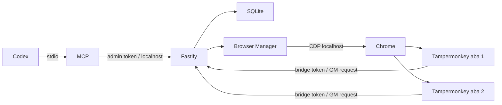

# Arquitetura e limites

Há um processo escritor HTTP; MCP pode ter vários clientes. SQLite WAL com busy_timeout e BEGIN IMMEDIATE protege a reserva. Transições críticas são síncronas e não cedem controle durante a transação. IDs de execução e prazos são conferidos em todas as respostas/anexos; heartbeat não ultrapassa o deadline. Após restart, reservas antigas são invalidadas e tentativas limitadas são recuperadas.

Browser Manager serializa aberturas/encerramentos, impõe capacidade, frequência e backoff. Só fecha Page objects que ele próprio criou nesta execução. Não enumera/adota páginas desconhecidas. Após restart, antigas abas permanecem desconhecidas para fechamento mesmo que o histórico indique managed=true. As abas podem registrar nova identidade via ponte, mas o controlador continua sem permissão para fechá-las. No shutdown, fecha suas próprias abas e desconecta CDP, preservando o processo externo do Chrome.

Cada documento usa instanceId aleatório; tabId e role persistem no sessionStorage. Duplicação de sessionStorage não duplica execução: o servidor atribui novo tabId/agentId. Tickets de uso único associam novas abas às reservas starting do gerenciador. Em reload de aba gerenciada pelo processo atual, CDP confere o nonce do documento no Page object proprietário antes de preservar agentId; invalida/reenvia eventual execução interrompida. Uma cópia em outra aba não passa essa verificação. Em abas manuais ou após restart, reload cria nova identidade; a anterior desconecta após heartbeat/lease. Uma tentativa pode ter produzido texto remoto antes da queda: não há garantia de execução exatamente uma vez na interface web. O resultado persistido tem proteção contra sobrescrita por tentativa antiga.

Reuso usa nova conversa por padrão. O userscript só envia se editor estiver disponível, vazio e sem geração ativa. Uma nova conversa usa navegação SPA; se seletor não existir, falha explicitamente. Desde a versão 0.1.3, taskId/executionId ficam no protocolo local, sem poluir o prompt. A confirmação localiza o texto visível normalizado da nova pergunta fora do editor; mantém a contagem anterior para diferenciar perguntas iguais na mesma conversa. Resposta elegível deve ter marcação de assistente reconhecida e seguir essa nova pergunta na ordem do DOM. Nunca usa texto arbitrário do body como resultado. Captura o conteúdo da mensagem (.markdown quando disponível), excluindo controles da interface, após estabilidade de 8s sem botão de parada, enviando parciais a cada 3s. Há deadline no cliente e servidor. Sem texto nem geração observável por 90s, retorna DOM_RESPONSE_TIMEOUT. Cancelamento é detectado no heartbeat e solicita parada na interface; não garante que o backend remoto interrompa imediatamente.

A versão 0.1.4 acrescenta captura de variantes sem marcação de autor. Depois de confirmar a pergunta, procura conteúdo rico após essa pergunta no mesmo contêiner de conversa. Se não houver, procura conteúdo adjacente à barra de ações de uma mensagem (grupo de 2 a 10 botões, sem texto fora dos controles). O contêiner comum não pode ser body/html nem incluir editor ou painel da ponte; a busca ignora regiões de navegação, formulários e mensagens anteriores. Registra o método no diagnóstico. Esse adaptador usa estrutura, não o valor esperado do resultado. Uma resposta visível não é importada manualmente para substituir o status failed de uma tentativa antiga.

O teste de Chrome usa página controlada e grants Tampermonkey simulados. A extensão, login, seletores atuais e permissões de conexão no ChatGPT real precisam do teste manual. Mudanças de DOM, throttling de abas em segundo plano, limites da conta, confirmações da interface ou desafios de autenticação podem impedir execução. O sistema não contorna essas condições. A conclusão por estabilidade do DOM é heurística, não evento oficial do ChatGPT.

Anexos: captura somente downloads blob explícitos na resposta. Links sandbox autenticados, artefatos Canvas e botões de download não expostos como blob não são baixados; o texto continua preservado. Não há download arbitrário de URLs, o que evita requisições induzidas pelo modelo. JSON pode ser null quando o agente responde com texto livre.

Limites da primeira versão: histórico é armazenado em JSON por registro e consultado em memória; indicado para uso local de poucos agentes. Não há retenção automática/limite global de disco, dashboard, streaming MCP ou migração de banco de uma ponte anterior. Faça backup com o servidor parado e gerencie o histórico/anexos localmente. Configuração de runtime não persiste. Nenhuma política local elimina limites compartilhados entre abas de uma conta ChatGPT.

Próximas evoluções: validar seletores na sessão real, implementar adaptadores de DOM versionados, retenção e índices SQL, mecanismos de retomada de identidade gerenciada entre reinícios e suporte documentado a anexos autenticados. Nunca incluir execução automática do código retornado no servidor da ponte.
